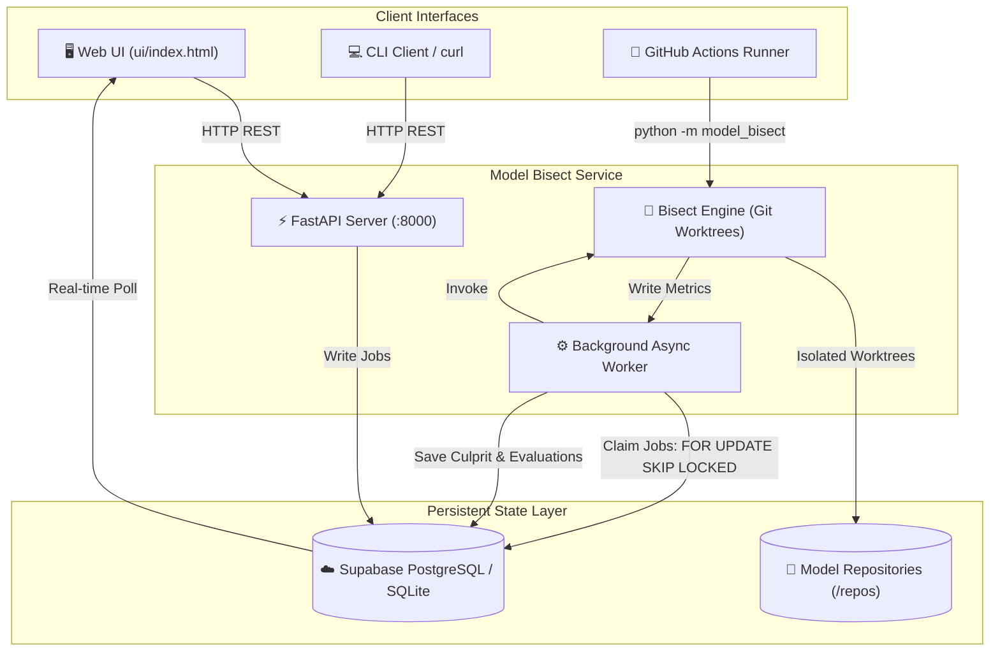

<div align="center">

# 🔬 Model Bisect

### **High-Precision Git Bisect for Machine Learning Models**

*Automatically identify the exact Git commit that caused your ML model’s evaluation metric to regress.*

[](https://github.com/harshitrajj23/Model-Bisect/actions)
[](https://www.python.org/)
[](https://fastapi.tiangolo.com)
[](https://supabase.com/)
[](LICENSE)
[](tests/)

---

[Key Features](#-key-features) • [Why Not Git Bisect?](#-why-not-git-bisect) • [Architecture](#-architecture) • [Quickstart](#-quickstart) • [Benchmark Targets](#-pre-configured-benchmark-targets) • [Web UI](#-interactive-web-viewer) • [Supabase Database](#-supabase--postgresql-schema) • [GitHub Action](#-github-actions-ci-integration) • [Security](#-security--threat-model)

</div>

---

## 💡 Why Not Standard `git bisect`?

Standard `git bisect` works brilliantly for traditional software with binary outcomes (pass/fail exit codes). In Machine Learning and AI engineering, regressions look completely different:

1. **Continuous Quantitative Metrics**: Regressions aren't process crashes—they are numeric drops (e.g., Accuracy drops from `0.96` to `0.88`, or latency spikes from `12ms` to `75ms`).
2. **Expensive Compute Budgets**: Re-training or evaluating a model at every commit is computationally prohibitive. Model Bisect enforces a hard theoretical budget cap of $\lceil \log_2(N) \rceil + 2$.
3. **Flaky & Non-Monotonic Behavior**: Stochastic seeds, noisy data splits, or intermittent regressions produce non-monotonic histories. Standard bisect can falsely blame a random innocent commit. Model Bisect validates monotonicity and flags flaky histories honestly.
4. **Isolated Worktrees**: Eliminates dirty working-tree headaches and cache invalidation by isolating every evaluation in a temporary Git worktree.

---

## ✨ Key Features

* **⚡ Deterministic Binary Search Engine**: Guaranteed compute ceiling $\lceil \log_2(N) \rceil + 2$. Never executes unbounded evaluations.
* **🛡️ Monotonicity Verification**: Validates whether the metric drop was a true regression or a non-monotonic noisy artifact.
* **📊 Dual-Mode Storage (Supabase + SQLite)**:
  * **Production Cloud**: Direct connection to **Supabase PostgreSQL** with `SELECT ... FOR UPDATE SKIP LOCKED` for race-free multi-worker queueing on AWS.
  * **Local Development**: Built-in **SQLite WAL mode** for instant, offline local hacking.
* **🎨 Premium Interactive Viewer**: Single-page web viewer (`ui/index.html`) with real-time polling, status pills, and hand-crafted responsive SVG trajectory visualizations—**zero build steps, zero external dependencies**.
* **🤖 GitHub Actions CI Bot**: Automatically bisects PR branches, comments the culprit commit onto the PR, and enforces status checks.
* **🔒 Enterprise Security First**: Strict target allowlisting, path traversal defense, and zero shell interpolation.

---

## 🏛️ Architecture



---

## 🚀 Quickstart

### Option 1: Docker Compose (Recommended for AWS & Production)

Start the API and background worker in isolated containers with a single command:

```bash
# 1. Clone repository
git clone https://github.com/harshitrajj23/Model-Bisect.git
cd Model-Bisect

# 2. Configure environment (optional: set DATABASE_URL for Supabase)
cp .env.example .env

# 3. Spin up full stack
docker compose up --build -d
```

* **Web UI**: Open `http://localhost:8000/ui/` in your browser.
* **API Documentation**: Open `http://localhost:8000/docs` (Swagger UI).
* **API Health Check**: `curl -s http://localhost:8000/health`

---

### Option 2: Local Python Environment

```bash
# 1. Create and activate virtual environment
python3 -m venv .venv
source .venv/bin/activate

# 2. Install dependencies
pip install -r requirements.txt

# 3. (Optional) Connect to Supabase
# If DATABASE_URL is set in .env, it connects to Supabase; otherwise falls back to SQLite.
cp .env.example .env

# 4. Terminal 1: Launch FastAPI Server
uvicorn model_bisect.api:app --host 0.0.0.0 --port 8000 --reload

# 5. Terminal 2: Launch Background Worker
python -m model_bisect.worker
```

---

## 🎯 Pre-Configured Benchmark Targets

Model Bisect ships with 5 diverse benchmark repositories under `repos/` (configured in `targets.toml`), demonstrating different regression scenarios:

| Target Name | Model Type | Metric & Direction | Good Commit | Bad Commit | Planted Culprit |
|---|---|---|---|---|---|
| **`sklearn_demo_target`** | Random Forest Classifier (Breast Cancer) | `accuracy` ($\ge 0.95$) | `040b2fd` | `058be49` | `85f2bce` (`c6: reduce n_estimators to 2`) |
| **`digits_target`** | Multi-Class Image Classification (Digits 0–9) | `accuracy` ($\ge 0.94$) | `ea89aca` | `9b439e8` | `2ffa810` (`c5: remove normalization & max_iter`) |
| **`latency_target`** | Inference Latency Benchmark | `latency_ms` ($\le 30.0$ ms) ⬇️ | `a123039` | `2564c4f` | `d0327c0` (`c4: unvectorized row loop`) |
| **`housing_target`** | Continuous Tabular Regressor (Diabetes) | `r2_score` ($\ge 0.40$) | `abd0619` | `e69d72c` | `68b0ec5` (`c3: over-regularized alpha=10000`) |
| **`alternating_target`** | Flaky / Non-Monotonic Detection | `accuracy` ($\ge 0.90$) | `5e80c65` | `3db46a7` | *Detects non-monotonic history* |

### Generating New Repositories:
You can build fresh test repositories anywhere using the included generator scripts:
```bash
python scripts/make_new_repos.py     # Generates digits, latency, and housing repos
./scripts/make_sklearn_repo.sh /tmp/my_model_repo   # Generates 12-commit sklearn demo
```

---

## 🖥️ Interactive Web Viewer

The Model Bisect single-page application (`ui/index.html`) is built from scratch without bulky frontend frameworks or build steps:

* **Real-Time Polling**: Watches queued and running bisect jobs with visual pulsing indicators.
* **Hand-Crafted SVG Trajectories**: Plots commit-by-commit metric progression with color-coded classification nodes (🟢 Good, 🔴 Bad, ⚪ Skipped).
* **Threshold Reference Line**: Dynamic dashed baseline reflecting the target threshold.
* **Culprit Inspector**: Highlights the culprit commit hash, commit message, evaluation count, and monotonicity verdict.
* **XSS Hardened**: Built strictly with native DOM manipulation (`createElement`, `textContent`) — `0` instances of `innerHTML`.

```
┌───────────────────────────────────┬────────────────────────────────────────────────────────┐
│  START BISECT JOB                 │  sklearn_demo_target  [ DONE ]                         │
│  Target: [sklearn_demo_target  ]  │  ID: 6c1de313-... | Range: 040b2fd..058be49           │
│  Good:   [040b2fd              ]  ├────────────────────────────────────────────────────────┤
│  Bad:    [058be49              ]  │  🎯 CULPRIT COMMIT IDENTIFIED: 85f2bce3                 │
│  Thresh: [0.95                 ]  │  "c6: reduce n_estimators to 2 (regression)"           │
│  [ Submit Bisect Job ]            │  Monotonicity: Verified | Evaluated: 6 commits         │
│                                   ├────────────────────────────────────────────────────────┤
│  RECENT JOBS                      │  Evaluation Trajectory                                 │
│  ● sklearn_demo_target     DONE   │   0.97 ───●───────●───────●                            │
│  ● digits_target           DONE   │   0.95 - - - - - - - - - - - - - - - - [ Threshold ]   │
│  ● latency_target          DONE   │   0.88 ───────────────────●───────●───────●            │
└───────────────────────────────────┴────────────────────────────────────────────────────────┘
```

---

## ☁️ Supabase & PostgreSQL Schema

When configured with `DATABASE_URL`, Model Bisect stores all jobs and individual commit evaluations into two relational tables in **Supabase**:

### 1. `jobs` Table (Job Summaries)
```sql
CREATE TABLE jobs (
    id TEXT PRIMARY KEY,
    target TEXT NOT NULL,
    good_commit TEXT NOT NULL,
    bad_commit TEXT NOT NULL,
    threshold_override DOUBLE PRECISION,
    status TEXT NOT NULL CHECK(status IN ('queued', 'running', 'done', 'failed')),
    created_at TIMESTAMPTZ NOT NULL,
    started_at TIMESTAMPTZ,
    finished_at TIMESTAMPTZ,
    progress_count INTEGER NOT NULL DEFAULT 0,
    result_json JSONB,
    error_message TEXT,
    culprit_commit TEXT,
    culprit_subject TEXT,
    metric_name TEXT,
    total_eval_count INTEGER,
    monotonicity_verified BOOLEAN,
    duration_seconds DOUBLE PRECISION
);
```

### 2. `job_evaluations` Table (Per-Commit Audit Log)
```sql
CREATE TABLE job_evaluations (
    id UUID PRIMARY KEY DEFAULT gen_random_uuid(),
    job_id TEXT NOT NULL REFERENCES jobs(id) ON DELETE CASCADE,
    commit_hash TEXT NOT NULL,
    metric_value DOUBLE PRECISION,
    status TEXT NOT NULL,
    duration DOUBLE PRECISION,
    skip_reason TEXT,
    created_at TIMESTAMPTZ DEFAULT now()
);
```

> **Concurrent Queueing**: Uses `UPDATE jobs SET status = 'running' ... WHERE id = (SELECT id FROM jobs WHERE status = 'queued' ORDER BY created_at ASC LIMIT 1 FOR UPDATE SKIP LOCKED) RETURNING *;` to guarantee no two worker containers ever evaluate the same job.

---

## 🤖 GitHub Actions CI Integration

Model Bisect includes a production GitHub Action workflow (`.github/workflows/model_bisect.yml`) that runs regression bisecting directly on Pull Requests:

1. **Add `.model-bisect.toml` to your repository:**
   ```toml
   eval_command = "python model/train.py"
   metric_name = "accuracy"
   threshold = 0.95
   direction = "higher"
   valid_range = [0.0, 1.0]
   timeout = 120.0
   repeat_count = 1
   ```

2. **How the Workflow Operates**:
   * Runs whenever changes in `model/**` or `models/**` are pushed to a PR branch.
   * Compares `github.event.pull_request.base.sha` against `github.event.pull_request.head.sha`.
   * Automatically posts the bisect verdict comment onto the PR:

> ### 🔍 Model Bisect Verdict
> ✅ **Culprit Commit Identified:** [85f2bce](https://github.com/harshitrajj23/Model-Bisect/commit/85f2bce)
>
> | Metric | Value |
> |---|---|
> | **Status** | `found` |
> | **Evaluations Performed** | `5` |
> | **Monotonicity Verified** | `true` |

---

## 📡 API Reference

### `POST /jobs`
Submit a new regression bisect job.
```bash
curl -X POST http://localhost:8000/jobs \
  -H "Content-Type: application/json" \
  -d '{
    "target": "sklearn_demo_target",
    "good_commit": "040b2fd",
    "bad_commit": "058be49",
    "threshold": 0.95
  }'
```
**Response (202 Accepted):**
```json
{
  "id": "e7678859-2d62-48f2-b0f8-c4ba6e8e0767",
  "target": "sklearn_demo_target",
  "status": "queued",
  "created_at": "2026-10-21T09:53:05.177850+00:00"
}
```

### `GET /jobs/{id}`
Retrieve real-time execution status and result payload for a job.

### `GET /jobs`
List the 20 most recent jobs. Accepts optional query filter `?status=done` or `?status=running`.

### `GET /health`
Liveness and database connectivity health probe. Returns `{"status": "ok", "database": "connected"}`.

---

## 🔐 Security & Threat Model

* **Zero Arbitrary Execution**: The API never accepts raw evaluation shell commands over the wire. All execution commands and repo paths are strictly defined in server-side configuration (`targets.toml`).
* **Allowlisted Repository Root**: Target paths are constrained to `MODEL_BISECT_REPO_ROOT`. Any directory traversal attempt (e.g., `../../etc/passwd`) is aborted with HTTP 400.
* **Strict Git Ref Sanitization**: Commit references are strictly validated against `^(?!-)(?!.*\.\.)[a-zA-Z0-9_./~^@-]+$`. Leading dashes (flag injection) and shell metacharacters (`$`, `;`, `&`, `|`, `` ` ``) are rejected with HTTP 422.
* **Safe Subprocesses**: Subprocess arguments are passed as explicit parameter lists without shell expansion (`shell=False`).
* **Non-Root Docker Container**: The container runs under an unprivileged user `appuser` (UID 1000).

---

## 🧪 Running Tests

The test suite contains 64 comprehensive tests covering adversarial cases, path traversal, git worktree cleanup failures, concurrent workers, and edge conditions:

```bash
# Run full test suite
pytest

# Run fast suite (excluding slow synthetic model training)
pytest -m "not slow"
```

---

<div align="center">
  <sub>Built with precision for machine learning infrastructure teams. Released under the MIT License.</sub>
</div>
